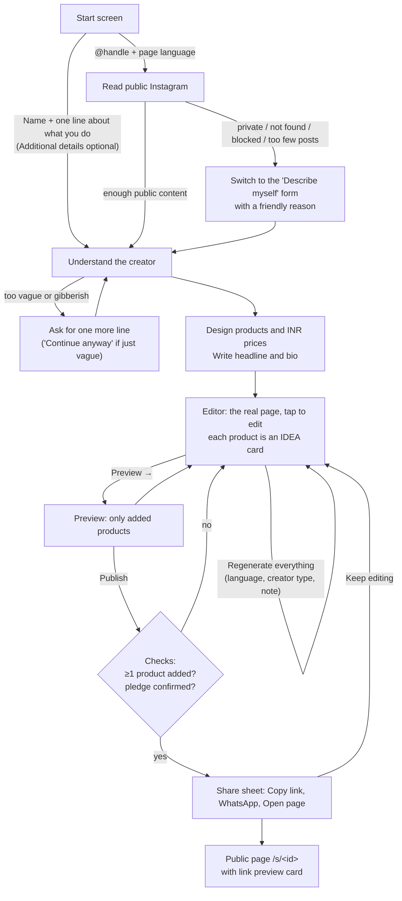

# User flow and main-screen alternatives

For the decision doc. The Mermaid diagrams render in GitHub, Notion and most Markdown viewers. Paste them into
[mermaid.live](https://mermaid.live) to export PNG/SVG, or redraw in Excalidraw.

## 1. Who and what the flow is optimised for

The primary user is an Indian micro-creator (5K to 100K followers) setting up **on a phone, between other work**, who has
never priced a product. The flow therefore aims for:

- **One required input.** An Instagram handle, or one line about what they do and what they create.
- **A finished page before any decisions.** They react to a real store instead of filling in a blank one.
- **Approve, don't author.** The AI proposes, the creator picks and tweaks. Nothing goes live without a tap from them.
- **Never a dead end.** Every failure routes to a next step.

## 2. Main flow



Progress is shown as named steps ("Reading your Instagram", "Understanding what you create", "Designing products
and prices", "Writing your page"), because a 20 to 60 second wait with a bare spinner feels broken on a phone.

## 3. Edge cases and where they land

| Situation | What the creator sees | Where they go next |
|---|---|---|
| Handle doesn't exist / private / scraping blocked | "That account is private…" plus "No problem, tell us a bit about yourself instead" | The manual form, already selected |
| Account has almost no public posts | Same, with "not enough public content to learn from" | The manual form |
| One word or gibberish | "We need a little more to go on: …" | Same form; "Continue anyway" if it was only vague |
| LLM returns invalid output | Nothing; it retries once with the exact error | Usually succeeds silently |
| LLM fails twice | A friendly error; their inputs stay in place | Try again (no fake content is shown) |
| A single rewrite fails | A toast; the rest of the page is untouched | Keep editing |
| Publishing with nothing added | "Add at least one product to your store first" | Editor |
| Cause creator hasn't confirmed the pledge | Scrolls to the pledge: "Tick 'I confirm this is true'…" | Editor |
| Opening a link that doesn't exist | A 404 page with "Build your own store" | Start screen |

## 4. Main screen: what we chose and what we rejected

The main screen is the editor, where creators spend most of their time.

### Chosen: the page itself is the editor, with an "add to store" cart

```
┌────────────────────────────────────────┐
│ ← Start over  [Edit|Preview] [Publish] │
│              ( avatar )                │
│        Name · headline · bio           │  ← tap any text to edit
│        [↻ Rewrite bio] [⋯]             │
│ ┌────────────────────────────────────┐ │
│ │ [＋ Add to my store]                │ │  ← the creator approves each idea
│ │ Title ...................... ₹ 499 │ │
│ │ [Ebook ▾]            Why ₹499? ▾   │ │  ← reasoning shown only to the creator
│ │ Description…                       │ │
│ │ [ Get the guide ]                  │ │
│ │ [↻ New idea] [⋯]                   │ │
│ └────────────────────────────────────┘ │
│ ┌ 🛒 2 products in store  [Preview →] ┐ │
└────────────────────────────────────────┘
```

Why:
- **What you see is what gets shared.** A non-technical creator doesn't have to translate form fields into a page in their head.
- **It works one-handed on a phone.** One column, big tap targets, a sticky cart bar within thumb reach.
- **The cart makes approval explicit.** The AI suggests up to 6 ideas, the creator adds up to 4. This guards against
  publishing something the AI got wrong (e.g. a claim about who founded their NGO).
- **Common actions are visible, rarer ones are a tap away.** ↻ New idea is always visible; "Rewrite with a note" and
  "Dismiss" sit behind ⋯ so cards stay clean.

### Rejected A: a form on the left with a live preview on the right

```
┌───────────────┬────────────────┐
│ Headline [  ] │   (preview)    │
│ Bio      [  ] │                │
│ Product 1     │                │
│  Title   [  ] │                │
│  Price   [  ] │                │
└───────────────┴────────────────┘
```

This is the standard desktop page-builder pattern. **Rejected** because it doesn't fit a phone: you either get two
cramped columns or have to keep switching tabs. It also feels like "filling a form", which is the blank-page
problem we are trying to remove.

### Rejected B: editing by chat ("make my bio shorter")

```
┌────────────────────────────────┐
│ AI: Here's your store ✨       │
│ You: make product 2 cheaper    │
│ AI: Done! ₹299 now.            │
│ [ type a message…          ➤ ] │
└────────────────────────────────┘
```

**Rejected** because it's slower than tapping a word to fix a typo, it hides what changed, and it needs the creator
to know what to ask for. We kept the useful part: "Rewrite with a note" is a one-line chat scoped to a single section.

### Rejected C: a step-by-step wizard (bio → products → prices → publish)

**Rejected** because it means four or more screens before the creator sees anything that looks like a store, and
every step is a decision they are not equipped to make (they have never priced a product). Showing a complete page
first and letting them react is faster and less intimidating.

### Rejected D: publishing every AI product automatically (no cart)

This was our first version. **Rejected** because it made the AI the author and the creator a proofreader. Wrong or
off-brand products could go live unnoticed. With the cart, every product on the public page was chosen by the creator.

## 5. Input screen: what we chose and what we rejected

- **Chosen:** two tabs, "I have Instagram" and "Describe myself", with one required field each. Everything else is
  in an "Additional details (optional)" accordion, and anything skipped is inferred from the one line.
- **Rejected: one smart field that accepts either a handle or a description.** It's fewer taps, but it's ambiguous
  ("is 'fitwithriya' a handle or a word?"), and creators without Instagram would read the screen as "this isn't for me".
- **Rejected: a long profile form up front** (audience, size, prices, credentials). Higher-quality input, but most
  people drop off before seeing any value. The same fields are still available, just optional.

## 6. Defaults and why

| Default | Why |
|---|---|
| English page, even if posts are in Hindi/Hinglish | A creator should choose the language of their storefront; we suggest a switch rather than doing it silently |
| Audience size "Not sure / skip" means conservative pricing | Under-pricing a first product is less harmful than over-pricing it; it's also overridden if the line says "30k followers" |
| Suggestions panel collapsed | It's useful but secondary; the store is the main task |
| Pledge unconfirmed | It's a public promise about money, so the creator must tick it themselves |
| Product ideas start un-added | Approval is a deliberate act; "Add all" exists for speed |

## 7. Deliberately not built (UX)

- **Accounts and login.** Publishing returns a private edit token held only in that browser tab, which removes a
  sign-up step from the first session.
- **Multiple visual themes.** One well-made style that looks good everywhere beats several mediocre ones within the time limit.
- **Checkout.** The buy buttons explain that checkout isn't enabled; payments are out of scope in the brief.
- **Drag-to-reorder products.** It's fiddly on phones, and added products keep a sensible order.
- **Saving drafts across visits.** Drafts last for the browser tab only; nothing is stored between visits.
